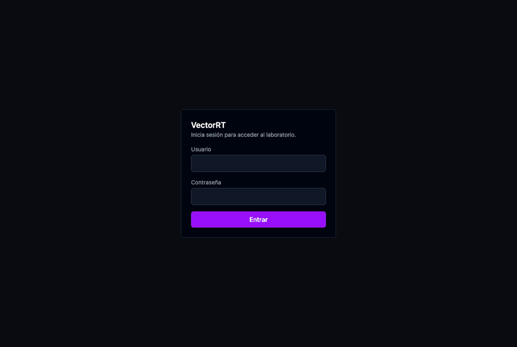
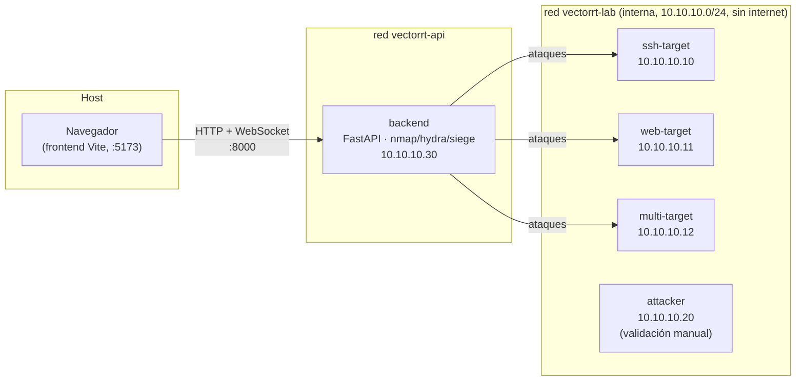

# VectorRT

Plataforma web para lanzar ataques controlados (escaneo de puertos, fuerza bruta SSH y prueba de carga / DoS) contra infraestructura **propia**, aislada en una red de laboratorio local con Docker.

<!-- Demo: guarda el GIF en docs/img/demo.gif y quita este comentario.
<p align="center">
  
</p>
-->

## Uso responsable

Esta herramienta está diseñada **exclusivamente** para ejecutarse contra hosts de un laboratorio propio, aislado de red (sin salida a internet ni a redes de terceros). No está pensada ni autorizada para atacar infraestructura que no controles o sobre la que no tengas permiso explícito.

- Nunca apuntes esta plataforma a IPs o dominios que no sean de tu propio laboratorio — el backend rechaza cualquier IP fuera de una whitelist fija, pero esa whitelist eres tú quien la define.
- No expongas el puerto del backend/frontend fuera de tu máquina sin entender las implicaciones (hay login, pero las credenciales por defecto son de desarrollo).
- No commitees credenciales reales ni claves de firma — usa `.env` / `.env.example` y `infra/.env` (ambos ignorados por git).

## Arquitectura

| Componente | Tecnología |
|---|---|
| Frontend | React + Vite + Tailwind |
| Backend | FastAPI + Uvicorn |
| Comunicación en vivo | WebSockets |
| Autenticación | JWT (login usuario/contraseña) |
| Cola de jobs | Lock en memoria (`asyncio.Lock`), un ataque a la vez por target |
| Base de datos | SQLite (SQLAlchemy), persistida en `backend/data/` |
| Herramientas de ataque | nmap, hydra, siege — instaladas dentro del contenedor del backend |
| Infra de lab | Docker Compose, red interna aislada (`internal: true`) |

El backend vive en **dos redes Docker**: la interna `vectorrt-lab` (`10.10.10.0/24`, sin salida a internet, donde también están los targets) para poder atacarlos, y una red normal `vectorrt-api` solo para publicar su puerto hacia tu máquina — Docker no publica puertos de un contenedor que esté únicamente en una red `internal`.



## Estructura del repositorio

```
VectorRT/
  frontend/                 # React + Vite + Tailwind
    src/
      components/           # TargetSelector, AttackButtons, ResultsPanel, HistoryTable, Login
      auth.js                # token de sesión (sessionStorage) + fetch autenticado
      App.jsx
  backend/                  # FastAPI
    app/
      auth.py                # login, JWT, dependencia get_current_user
      config.py               # whitelist de targets, credenciales SSH/carga del lab
      db/                      # modelos y sesión SQLAlchemy (SQLite)
      models/                  # esquemas Pydantic de request/response
      routers/                 # /api/auth, /api/attacks, /ws/attacks
      services/                # nmap/hydra/siege, cola de jobs, runner de ataques
    tests/                    # pytest
  infra/                     # laboratorio Docker Compose
    docker-compose.yml
    targets/                  # Dockerfiles de ssh-target, web-target, multi-target
    attacker/                 # Dockerfile del contenedor de validación manual
  docs/
    topologia-lab.md          # IPs, roles y puertos del laboratorio
```

## Requisitos

- **Docker Desktop** — todo el laboratorio y el backend corren en contenedores multi-arch (funciona igual en Apple Silicon que en Intel).
- **Node.js 18+** y **npm** — para el frontend en modo desarrollo.
- **Python 3.11+** — opcional, solo si quieres correr el backend fuera de Docker o ejecutar los tests localmente.

## Primeros pasos

### 1. (Opcional) Configura tus propias credenciales

Por defecto el backend arranca con usuario `admin` / contraseña `changeme` y una clave de firma de desarrollo — funciona, pero el propio backend te avisará por log de que son valores de desarrollo. Para cambiarlos:

```bash
cp infra/.env.example infra/.env
# edita infra/.env con tu usuario/contraseña y una clave propia:
python3 -c "import secrets; print(secrets.token_hex(32))"
```

`docker compose` carga `infra/.env` automáticamente por estar en el mismo directorio que `docker-compose.yml`.

### 2. Levanta el laboratorio + el backend

```bash
cd infra
docker compose up -d --build
docker compose ps   # confirma que los 5 contenedores están "Up"
```

Esto construye y arranca `ssh-target`, `web-target`, `multi-target`, `attacker` (para validación manual) y `backend` — este último ya incluye `nmap`, `hydra` y `siege`, y publica la API en `http://localhost:8000`.

Verifica que todo responde:

```bash
curl http://localhost:8000/health
# {"status":"ok","db":true}
```

### 3. Levanta el frontend

```bash
cd frontend
npm install
npm run dev
```

Abre la URL que imprima Vite (normalmente `http://localhost:5173`). El proxy de desarrollo (`vite.config.js`) reenvía `/api` y `/ws` al backend en `localhost:8000`.

### 4. Inicia sesión

Usa las credenciales del paso 1 (`admin` / `changeme` si no las cambiaste). La sesión se guarda en `sessionStorage` del navegador — sobrevive a recargas de página, no a cerrar la pestaña.

### 5. Usa la plataforma

1. Selecciona un target del desplegable (poblado desde la whitelist real del backend).
2. Lanza un ataque: **Escaneo de puertos**, **Fuerza bruta SSH**, o **Prueba de carga (DoS)** (con duración y concurrencia acotadas).
3. El resultado se transmite en vivo por WebSocket a la terminal en pantalla.
4. Cada ejecución queda registrada en el **Histórico**, con botón "ver detalle" para el output completo.
5. Si lanzas dos ataques contra el mismo target a la vez, el segundo se rechaza ("target ocupado") hasta que el primero termine.

### Apagar todo

```bash
cd infra
docker compose down
```

Los datos (SQLite + logs) viven en `backend/data/` en tu máquina, montados como volumen — sobreviven a `docker compose down` y a reconstruir las imágenes.

## Ejecutar los tests del backend

```bash
cd backend
python -m venv venv        # si no lo tienes ya creado
source venv/bin/activate
pip install -r requirements-dev.txt
pytest
```

## Estado y próximos pasos

Hecho:

- [x] Laboratorio Docker aislado: tres targets y una red interna sin salida a internet.
- [x] Backend con lista blanca de targets y los tres módulos de ataque: nmap, hydra y siege.
- [x] Frontend con la salida en directo por WebSocket.
- [x] Persistencia en SQLite, cola de jobs (un ataque a la vez por target) e histórico.
- [x] Autenticación JWT, rate limiting, logging rotado y `/health` con chequeo de la base de datos.

Próximos pasos:

- [ ] **Blue Team:** detectar los propios ataques con fail2ban en el target SSH y Suricata en la red del laboratorio, y mostrar en el frontend si cada ataque fue detectado o bloqueado.
- [ ] **Informe automático** de cada sesión (ataques, targets y detecciones), como un mini informe de pentest.
- [ ] **Escalar el backend:** Redis para el lock y el rate limiter, una cola de jobs real y PostgreSQL en lugar de SQLite.
- [ ] **Multiusuario con roles** y registro de auditoría.
- [ ] **Más variedad en el laboratorio:** nuevos targets y módulos de ataque.

La topología de red del laboratorio está en [docs/topologia-lab.md](docs/topologia-lab.md).

## Seguridad implementada en la propia plataforma

- **Whitelist de targets**: todo endpoint (REST y WebSocket) valida el target contra una lista fija en `app/config.py` antes de ejecutar nada.
- **Sin inyección de comandos**: los ataques se ejecutan con `asyncio.create_subprocess_exec` y listas de argumentos fijas — nunca `shell=True` ni concatenación de strings del usuario.
- **Validación de inputs**: Pydantic valida IPs (`IPvAnyAddress`) y acota duración/concurrencia del test de carga (`Field(ge=..., le=...)`), con los mismos límites duros repetidos en el propio servicio por si acaso.
- **Autenticación**: login JWT; todos los endpoints de ataque y el WebSocket de streaming exigen un token válido.
- **Rate limiting**: 10 peticiones/minuto por IP en login y en cada endpoint de ataque (`slowapi`), para que ni tú mismo lances 50 ataques por error en un bucle.
- **Cola de jobs**: un único ataque a la vez por target, aplicado tanto en REST como en WebSocket.
- **Observabilidad**: logging rotado a fichero (`backend/data/vectorrt.log`) y todo ataque queda persistido en SQLite con su estado, duración y output completo.
